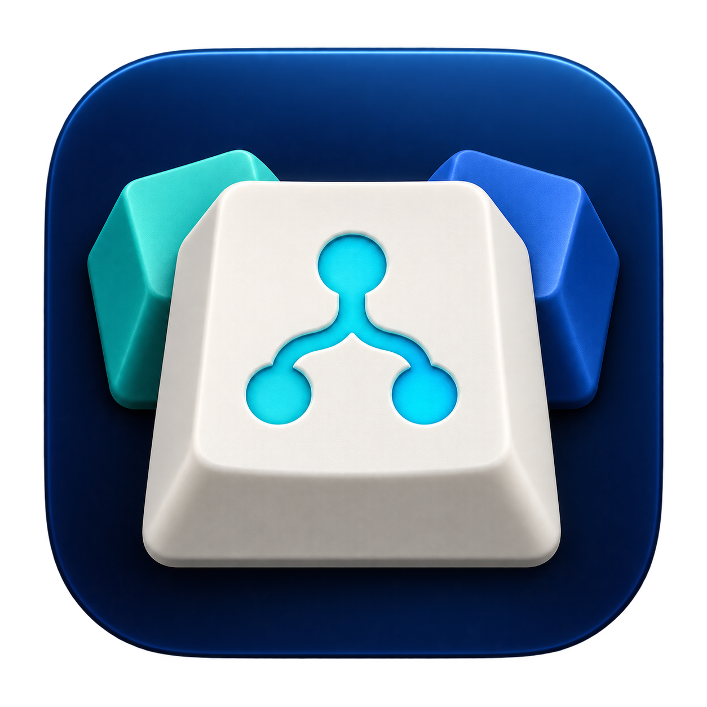

# R3Ds VIA-L



[English](README.en.md)

**R3Ds VIA-L**, kurz **VIA-L**, bringt [VIA](https://usevia.app/), [Vial](https://vial.rocks/), [Venom](https://venom.how/) und [Wootility](https://wootility.io/) in eine eigenständige macOS-App. Verbinde deine kompatible Tastatur, passe Tastenbelegungen an und verwalte deine Layouts über die vertraute Oberfläche des jeweiligen Tools. Zwischen VIA, Vial, Venom und Wootility wechselst du direkt in der App.

VIA-L lädt die **Online-Versionen** der vier Tools und ergänzt eine lokale Geräteauswahl für WebHID. Eine Internetverbindung ist erforderlich. VIA-L ist ein unabhängiges Projekt und gehört zu keinem der vier Originalprojekte.

Neu in Version 0.2.6: Behebt das Speichern und Laden von Vial-Layouts im `.vil`-Format.

Der Vial-Layout-Fix wurde am korrigierten lokalen Build getestet und für gut befunden.

**Downloads für Version 0.2.6:** [Apple Silicon (arm64)](https://github.com/r3d42-git/R3Ds-VIA-L/releases/download/v0.2.6/VIA-L-0.2.6-macOS-arm64.zip) · [Intel (x64)](https://github.com/r3d42-git/R3Ds-VIA-L/releases/download/v0.2.6/VIA-L-0.2.6-macOS-x64.zip) · macOS 13 oder neuer · signiert und von Apple notarisiert.

Wähle unter ** → Über diesen Mac**: Bei „Chip: Apple …“ passt Apple Silicon, bei „Prozessor: Intel …“ passt Intel. Beide ZIPs enthalten dieselbe App für den jeweiligen Prozessor.

Das ZIP entpacken und **VIA-L.app** in den Programme-Ordner verschieben. Neue Versionen werden über die Release-Seite bereitgestellt. Zum Aktualisieren die App regulär beenden und austauschen; Websitedaten und Einstellungen bleiben erhalten.

## Verwendung

1. VIA, Vial, Venom oder Wootility in der oberen Leiste wählen. Beim Wechsel wird die bisherige Webansicht geschlossen; ungesicherte Änderungen auf der Webseite können verloren gehen.
2. Auf der Originalseite eine Verbindung anfordern: bei VIA über **„Gerät autorisieren +“**, bei Vial über **„Start Vial“**, bei Venom über **„Connect“**, bei Wootility über **„Initialisiere ein Gerät“ → „Erlaube dem Browser“**. In VIA-L das angebotene Gerät markieren und **„Verbinden“** wählen. Die Auswahl gibt kein Gerät ohne Bestätigung frei.
3. Tastenbelegungen und Layouts direkt im gewählten Tool anpassen.
4. Import und Export über die Funktionen des jeweiligen Tools nutzen. Vial speichert `.vil`-Layouts über **File → Save current layout…** und lädt sie über **File → Load saved layout…**. Für eine VIA-JSON-Datei steht die Sideload-Funktion von VIA zur Verfügung.

Die App-Leiste ist während eines Tastentests bewusst aus der Tab-Reihenfolge genommen und per Maus bedienbar. Einstellungen und Geräteauswahl bleiben per Tastatur bedienbar. Beim Löschen von Websitedaten muss der Name des betroffenen Tools exakt eingegeben werden. Der Reset betrifft nur dieses Tool.

## Entwicklung

Voraussetzungen: macOS, Node.js ab 22.12 und npm. Die Entwicklung erfolgt auf Apple Silicon.

```sh
npm ci
npm start
```

```sh
npm test            # Build und gezielte Tests für Regeln und Zustände
npm run test:app    # Laufzeittest mit isoliertem Entwicklungsprofil
npm run test:focus  # Fokus- und Reset-Test mit isoliertem Entwicklungsprofil
npm run test:window # Fensterstart auf realer und simulierten kleinen Arbeitsflächen
npm run package:mac # lokales App-Bundle für den aktuellen Mac
npm run package:mac -- --arch=x64 # lokales Intel-App-Bundle
npm run package:mac -- --arch=arm64 # lokales Apple-Silicon-App-Bundle
```

`npm start` baut den TypeScript-Code und startet Electron. Der erste Bezug von Electron und die vier Webseiten erfordern Internetzugriff. Tests mit Testprofilen verwenden eine eigene Datenablage und greifen nicht auf das reguläre Benutzerprofil zu.

VIA-L startet auf dem Bildschirm unter dem Mauszeiger mit **1676 × 1124** macOS-Punkten, sofern die nutzbare Arbeitsfläche diese Größe zulässt. Andernfalls wird das Fenster unter Berücksichtigung von Menüleiste und Dock passend begrenzt und zentriert. Bei jedem Start wird die Zielgröße neu bestimmt; manuell gespeicherte Fenstergrenzen werden ignoriert. Einstellungen, Zoom und Websitedaten bleiben erhalten.

## Schutz und Daten

Die Online-Seiten laufen in isolierten Webansichten ohne Node-Integration oder App-Preload. Dokumentnavigation ist auf die jeweilige HTTPS-Origin beschränkt. Externe Links benötigen eine Bestätigung, bevor der Standardbrowser sie öffnet. Jede Seite erhält eine eigene persistente Chromium-Partition. Der Wechsel schließt die vorherige Webansicht. WebHID wird nur für das aktive Tool und eine konkrete Geräteauswahl zugelassen. Die aktive Vial-Ansicht darf einzelne über Chromiums Dateidialog gewählte Dateien lesen und schreiben; Verzeichniszugriff bleibt gesperrt. Andere Berechtigungen werden standardmäßig abgelehnt.

Einstellungen, Zoom und Websitedaten werden lokal im Benutzerprofil gespeichert. VIA-L hat keine eigene Cloud, keine eigene Telemetrie und keinen Hintergrunddienst. Die Online-Seiten können eigene Ressourcen und Dienste nutzen; deren Datenverarbeitung liegt bei den jeweiligen Betreibern. Der Reset in den Einstellungen löscht die Daten des gewählten Tools und wechselt zu einer neuen Partition. Nach einem vollständigen App-Neustart ist eine erneute Gerätefreigabe erforderlich.

VIA-L nutzt für bestehende Installationen weiterhin das bisherige macOS-Profil **Keyboard Web Tools**. Bei der Umbenennung werden Profildaten weder verschoben noch gelöscht. Die technischen Partitionsnamen bleiben aus demselben Grund erhalten.

## Lizenz und Drittanbieter

Der Quellcode von VIA-L steht unter [GPL-3.0-or-later](LICENSE). Hinweise zu gebündelter Software und zu den unabhängigen Online-Angeboten stehen in [THIRD_PARTY_NOTICES.md](THIRD_PARTY_NOTICES.md). Fehler und Vorschläge können über [GitHub Issues](https://github.com/r3d42-git/R3Ds-VIA-L/issues) gemeldet werden.

Build-, Signatur- und Veröffentlichungsablauf: [RELEASE.md](RELEASE.md).
